<p align="center">
  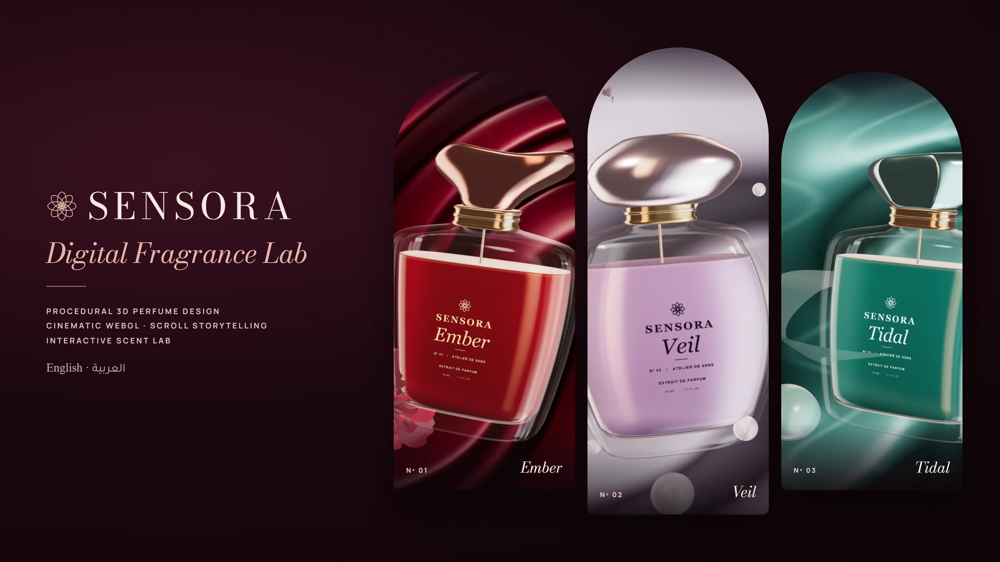
</p>

<h1 align="center">SENSORA</h1>
<p align="center"><b>Digital Fragrance Lab</b><br><i>Wear what you feel.</i></p>

<p align="center">
  <a href="https://sensora-cyan.vercel.app/en"><b>Live experience</b></a> &nbsp;·&nbsp;
  <a href="https://sensora-cyan.vercel.app/ar"><b>النسخة العربية</b></a> &nbsp;·&nbsp;
  <a href="docs/CASE_STUDY.md"><b>Case study</b></a> &nbsp;·&nbsp;
  <a href="docs/media/preview.mp4"><b>Motion preview (MP4)</b></a>
</p>

---

SENSORA is a cinematic, single-page fragrance film for the browser. One persistent real-time studio carries a perfume bottle through seven chapters. It opens on a first breath, reveals the invisible, travels through three fragrance worlds and arrives at an interactive Scent Lab, whose composition carries into a closing ritual. Every bottle, stopper, liquid, label and sculpture is generated in code with Three.js. No model files, HDRIs or texture downloads are involved. The whole experience runs in English and in fully composed Arabic.

> SENSORA is an independent creative-development portfolio concept. The fragrances are fictional and nothing is for sale.

<p align="center">
  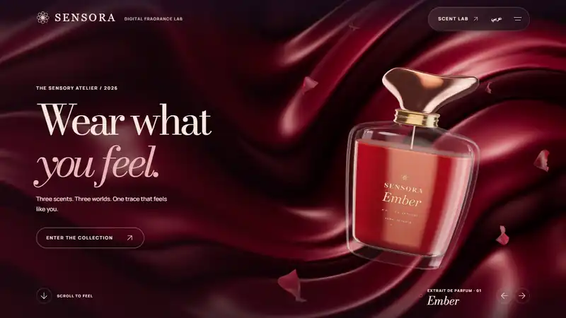
  <br><sub>Real capture of the production build (12 fps preview, 36 s; full-quality <a href="docs/media/preview.mp4">MP4</a>).</sub>
</p>

## Fragrance worlds

<p align="center">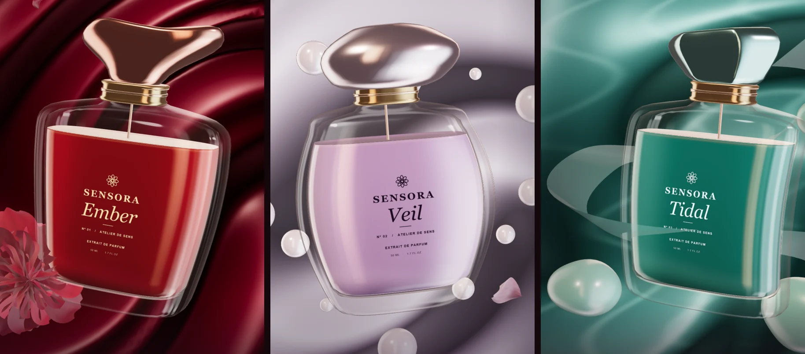</p>

| | World | Bottle |
|---|---|---|
| **Nº 01 · EMBER** | Garnet silk folding around the bottle, drifting rose petals and a sculpted bloom. *Black cherry, rose, amber.* | Tapered shoulders, a flared rose-gold crest and a deep crimson liquid |
| **Nº 02 · VEIL** | Pearl-grey gauze, orbiting pearls, soft diffused light. *Iris, violet leaf, clean musk.* | A rounded barrel body, a luminous pebble stopper and lilac liquid with dark-ink print |
| **Nº 03 · TIDAL** | Turquoise satin with caustic light, a translucent water ribbon and polished sea-glass minerals. *Sea salt, bergamot, cedar.* | A straight mineral body, a slanted faceted stopper and sea-glass liquid |

The three editions share one ring topology. Glass, liquid, stopper and label therefore **morph together** when the visitor changes fragrance, instead of swapping models.

## Experience highlights

| | |
|---|---|
| **Procedural perfume bottles** | Superellipse cross-sections lofted through a hand-tuned profile, side fluting that fades into the shoulder, a heavy optical heel, an inset liquid volume with a meniscus, three sculpted stoppers, a machined collar and label print set directly on the glass. In total: 23 k vertices, with two morph targets per morphing part. |
| **Cinematic silk** | A vertex-displaced shader cloth with three fold regimes (draping garnet satin, gauze, swell). It gathers around the bottle's position, receives a pointer-driven light focus and has per-pixel normals with output dithering. |
| **One persistent studio** | One canvas, one camera and one product for the whole page. Scene weights, sky, silk colour, sculptures and edition morphs are interpolated from scroll position, so no chapter remounts the scene. |
| **Scroll film** | A paused GSAP master timeline is *sampled*, not played. Scroll position maps to a time, so every shot holds, travels, orbits and rolls identically in both directions. Lenis smooths the wheel and can be switched off. |
| **Editorial framing** | Each chapter reserves a product rectangle on its editorial grid. The renderer fits the bottle into that measured space beneath the header, so product and typography never collide, from 360 px phones to 1920 px displays. |
| **Interactive Scent Lab** | Three worlds and three sliders that genuinely change the render. Intensity changes liquid depth, warmth shifts hue and textile light, and airiness spreads the petals. The visitor's composition carries into the Ritual, survives a language switch and downloads as a localized signature card. |
| **Bilingual by design** | Complete Arabic (Amiri display, Tajawal text) with mirrored compositions, a mirrored studio light and silk direction, and Arabic-safe text animation that never splits joined letters. |
| **Accessible** | Semantic chapters, a native-dialog chapter index with focus return and scroll locking, keyboard-operable Lab, visible focus, reduced-motion mode (still studio, no smoothing) and a complete fallback edition when WebGL is unavailable. |

## Gallery

<table>
<tr><td colspan="2">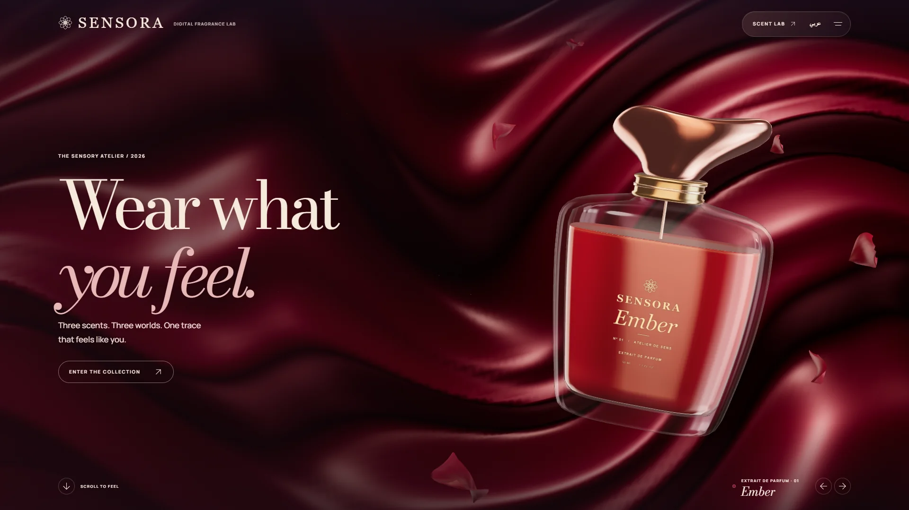<br><sub><b>First Breath</b>: the Ember bottle on garnet silk, with an edition switcher in the corner.</sub></td></tr>
<tr>
<td width="50%">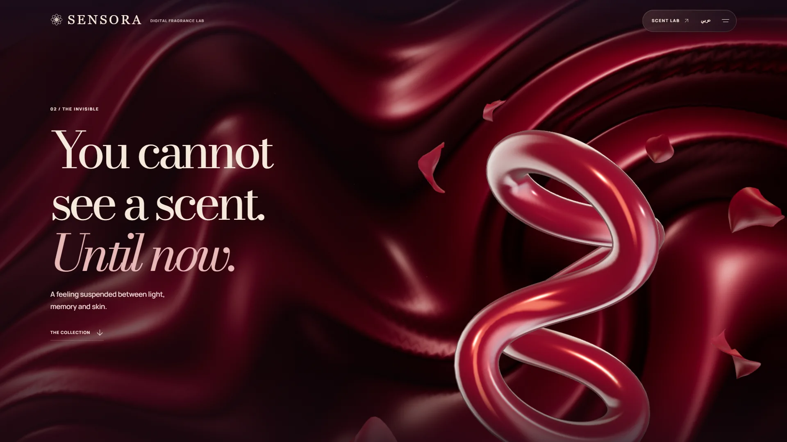<br><sub><b>The Invisible</b>: the bottle dissolves into an iridescent sculpture.</sub></td>
<td width="50%">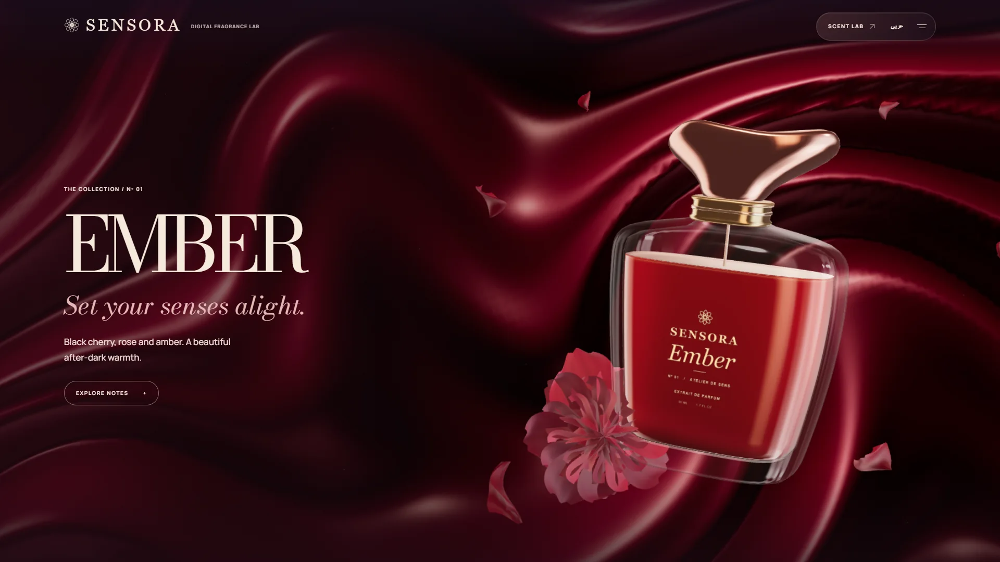<br><sub><b>Ember</b>: a sculpted bloom and petals around the flared crest.</sub></td>
</tr>
<tr>
<td>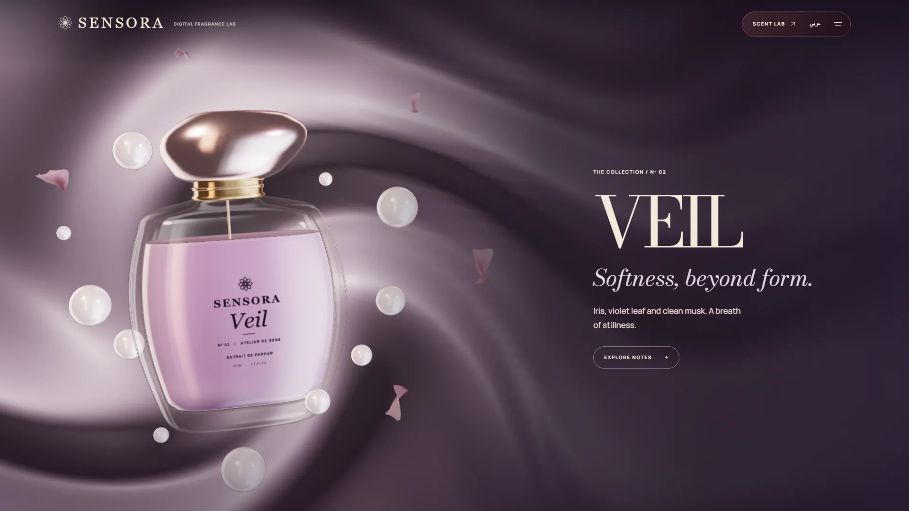<br><sub><b>Veil</b>: pearl gauze, an orbit of pearls and the pebble stopper.</sub></td>
<td>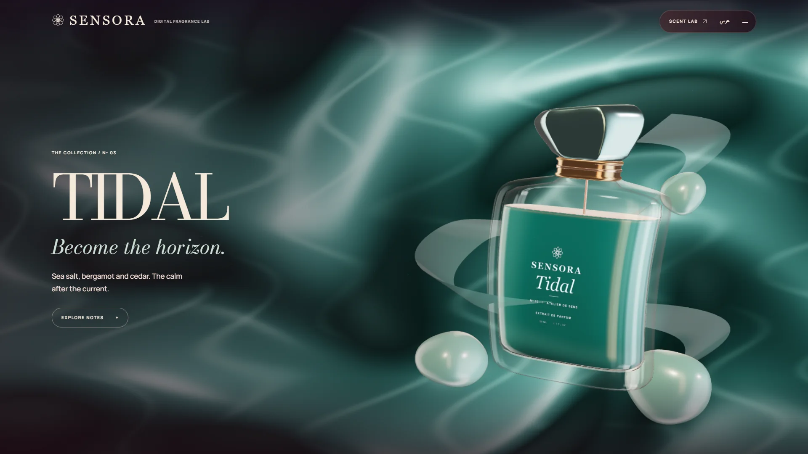<br><sub><b>Tidal</b>: caustic satin, a water ribbon and sea-glass minerals.</sub></td>
</tr>
<tr>
<td>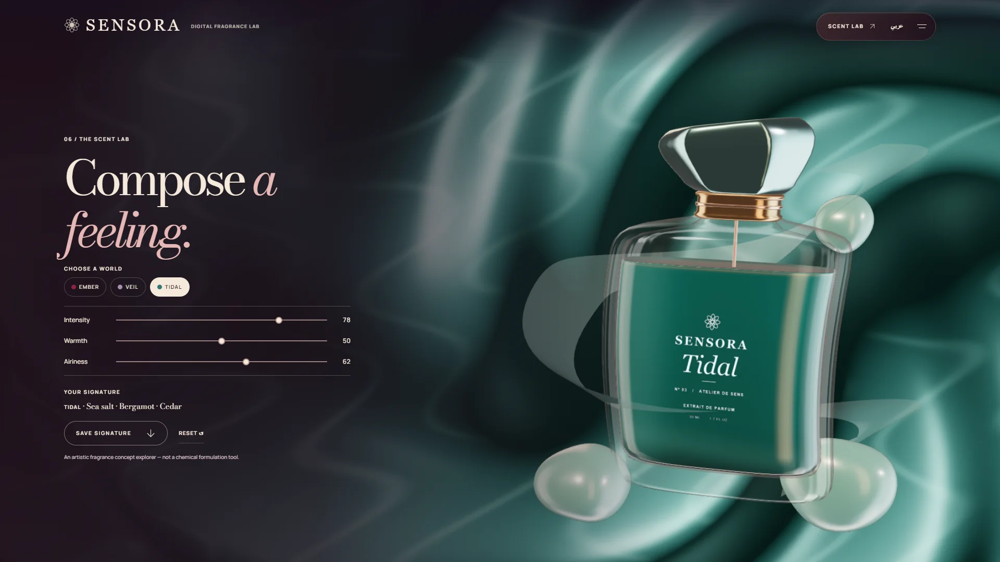<br><sub><b>Scent Lab</b>: Tidal chosen, with intensity and airiness raised live.</sub></td>
<td>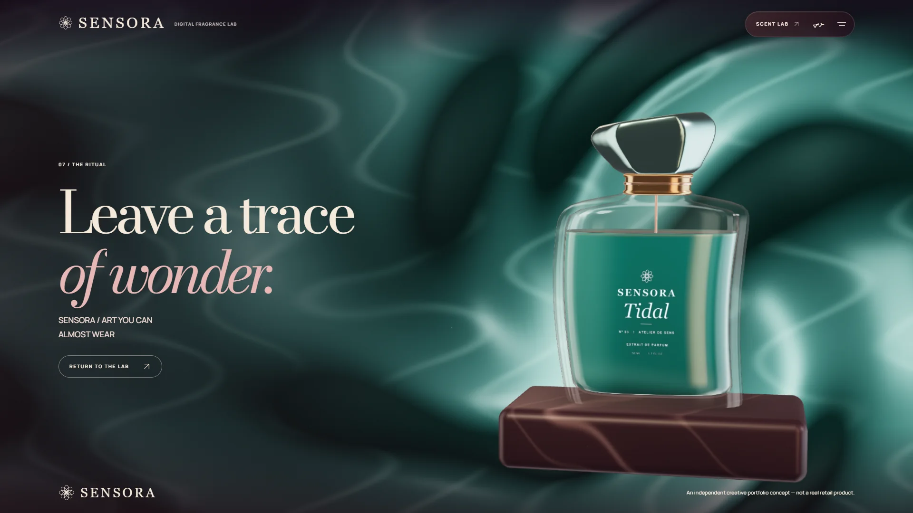<br><sub><b>The Ritual</b>: the composed edition arrives on a plinth tinted to match.</sub></td>
</tr>
<tr>
<td>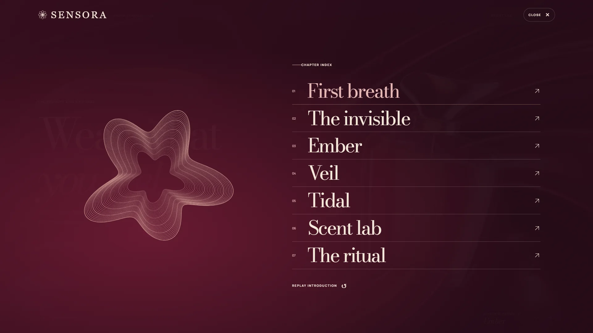<br><sub><b>Chapter index</b>: a masked full-screen dialog with an engraved plate.</sub></td>
<td>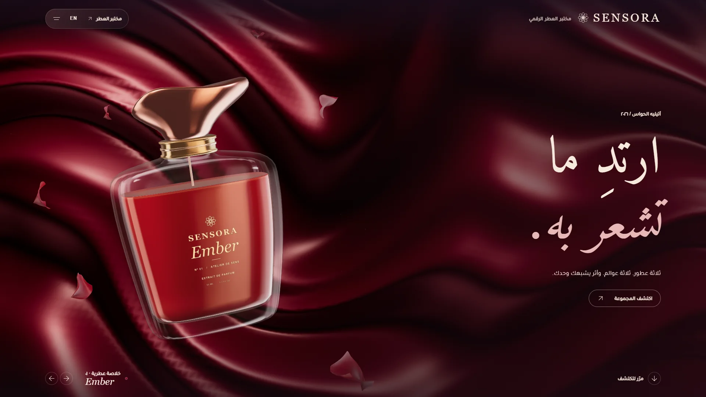<br><sub><b>Arabic (RTL)</b>: mirrored staging, with Amiri and Tajawal.</sub></td>
</tr>
<tr>
<td>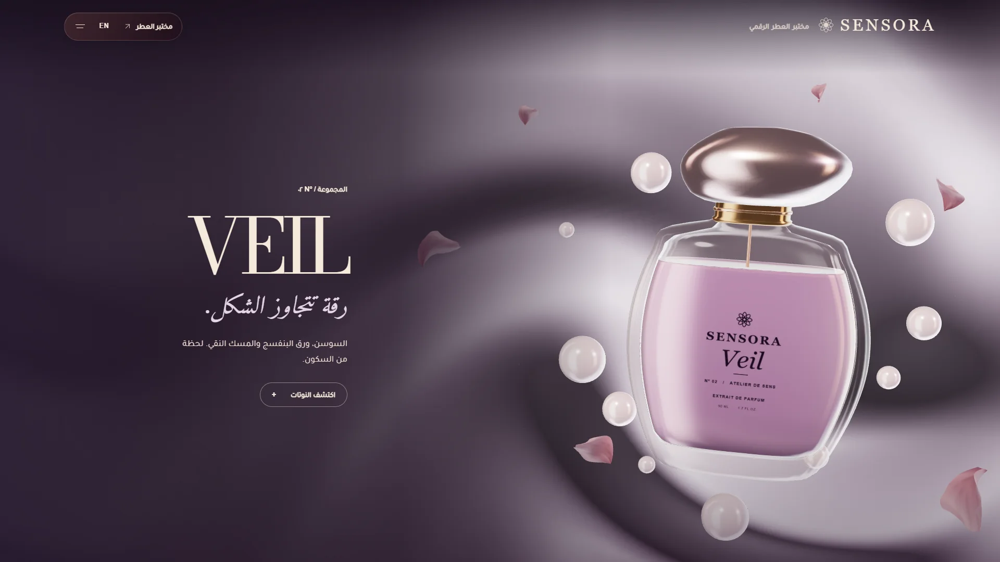<br><sub><b>Arabic Veil</b>: the product moves to the opposite side of the copy.</sub></td>
<td>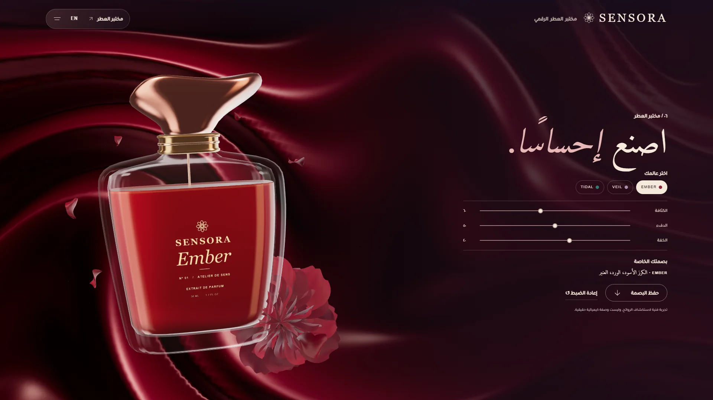<br><sub><b>Arabic Scent Lab</b>: Arabic-Indic numerals in the live readouts.</sub></td>
</tr>
<tr><td colspan="2">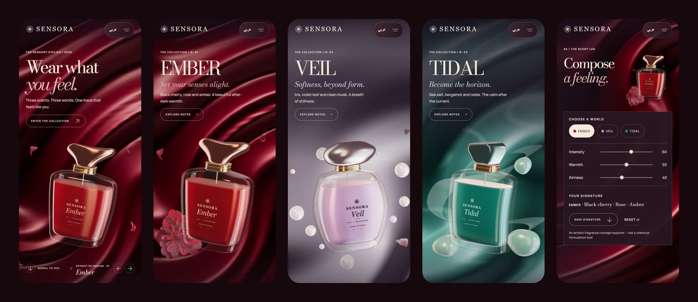<br><sub><b>Phone</b>: portrait compositions with their own framing, not scaled-down desktop.</sub></td></tr>
<tr><td colspan="2">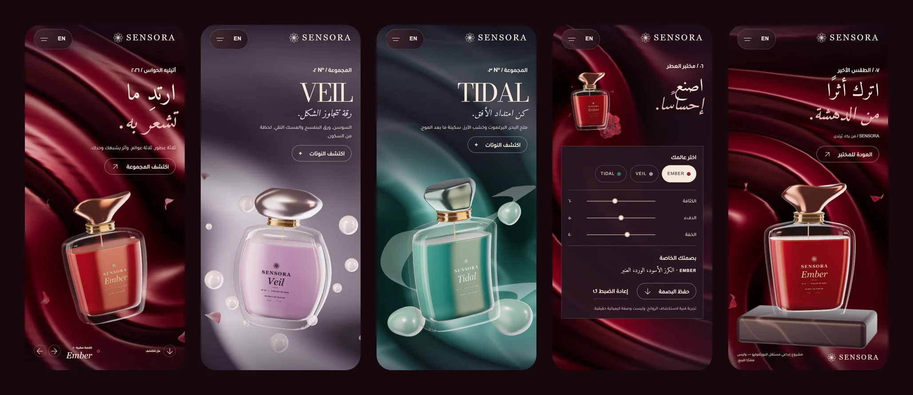<br><sub><b>Arabic on phone</b>: hero, Veil, Tidal, Lab and Ritual.</sub></td></tr>
</table>

## Technical architecture

| Area | Used |
|---|---|
| Framework | Next.js 16 (App Router, statically generated `/en` and `/ar`), React 19, TypeScript (strict) |
| 3D | Three.js r182, React Three Fiber 9, one Drei helper (`RoundedBox`) |
| Motion | GSAP 3 + ScrollTrigger, Lenis |
| Styling | Hand-written editorial CSS with logical properties (Tailwind 4 pipeline); Bodoni Moda, Manrope, Amiri and Tajawal served locally through Fontsource |
| Quality | ESLint, `tsc --noEmit`, Playwright suites for journeys, responsive bounds, scroll reversal, Lab rendering and GPU frame sampling |

```
app/[locale]/        layout (localized metadata, lang/dir, fonts) and page — /en, /ar
components/
  Experience.tsx     client shell: hero, header, fallback, prologue, chapter state
  Stage.tsx          persistent R3F canvas: studio, bottle, silk, petals, camera, adaptive quality
  WorldObjects.tsx   chapter sculptures: iridescent loop, pearls, water ribbon, minerals, bloom, plinth
  useJourney.ts      scroll sampling of the master timeline, Lenis, typography ScrollTriggers
  Stories.tsx, Lab.tsx, ChapterIndex.tsx, Prologue.tsx, MotionText.tsx
lib/
  model.ts           procedural bottle: profiles, superellipse lofts, edition morphs, label print
  surfaces.ts        studio radiance, silk shader, liquid/glass/stone shader patches, petals
  framing.ts         measured product rectangles → scene position and scale
  scents.ts          editions, palette, chapter → edition mapping, shared director state
copy/en.json, copy/ar.json   all visible copy
qa/                  Playwright QA scripts and the final audit report
```

**Rendering pipeline in short.** React mounts the scene once. A mutable *director* object holds scroll progress, passage, roll, pointer, chosen edition and Lab formula. Event handlers write to it, and the frame loop reads from it. React therefore never re-renders per frame. Settled editions bind fixed vertex buffers. Morph interpolation runs only during an edition change. Petals and pearls are instanced, so a typical frame is **11–15 draw calls**.

## Performance engineering

- **Two glass paths.** Capable GPUs render full framebuffer transmission. Integrated graphics use a Fresnel-weighted reflective shell over the separate liquid volume, which keeps the same silhouette, fluting and colour without a second scene pass.
- **Adaptive density.** Discrete GPUs render at up to 1.5×. Integrated GPUs try 1.25× and settle once on the CSS pixel grid if they cannot hold 45 fps, which avoids visible resolution changes. A further tier engages only on sustained frames under 35 fps.
- **Cloth fitted to the camera.** The silk grid is sized to the visible plane, so vertex work tracks the viewport instead of a fixed oversized mesh.
- **Frame loop discipline.** Hidden tabs stop rendering. Reduced motion switches to on-demand frames. There are no DOM measurements in the frame loop.

Measured on an **Intel UHD Graphics 630** (headless Chromium, ANGLE/D3D11, production build, isolated 4.5 s samples per chapter):

| Viewport | Hero | Ember | Veil | Tidal | Lab | Ritual |
|---|---:|---:|---:|---:|---:|---:|
| 1440 × 900 @1× | 56.6 fps | 53.3 | 53.7 | 53.3 | 51.0 | 59.3 |
| 1536 × 864 @1.25× (125 % laptop display) | 58.3 | 51.9 | 53.3 | 52.0 | 44.8 | 47.5 |
| 390 × 844 @3× (emulated phone, same GPU) | 59.7 | 60.1 | 60.2 | 59.6 | 60.2 | 60.2 |

Full method, raw data and limits are in the [audit report](qa/final-audit/AUDIT_REPORT.md). No discrete-GPU or physical-phone figures are claimed.

## Getting started

Requirements: Node.js 20.9 or newer and npm. No environment variables or API keys are required.

```bash
git clone https://github.com/Youssef-Elalfy/sensora.git
cd sensora
npm ci
npm run dev          # http://localhost:3000 → /en  (Arabic: /ar)
```

```bash
npm run lint         # ESLint
npm run typecheck    # tsc --noEmit
npm run build        # production build (static /en and /ar)
npm start            # serve the production build
```

`NEXT_PUBLIC_SITE_URL` optionally overrides the canonical and Open Graph origin. On Vercel the production domain is detected automatically.

<details>
<summary><b>Browser QA</b> (Playwright, against <code>npm start</code>)</summary>

Install Chromium once with `npx playwright install chromium`, then set `SENSORA_QA_URL` to the local origin:

```bash
node qa/final-audit/functional.mjs                 # worlds, Lab → Ritual, language persistence, index, reversal, 10 viewports × EN/AR, fallback
node qa/final-audit/tour.mjs en 1440 900           # screenshots of all seven chapters
node qa/final-audit/performance.mjs 1440 900 1 desktop   # GPU frame sampling per chapter
node qa/reversal.mjs                               # model-view matrices compared forward vs backward
node qa/lab-render.mjs                             # pixel changes for every Lab control
```

Captures are written under `qa/` and are not committed.
</details>

## Deployment

The project deploys to Vercel with the default Next.js preset: `npm ci`, `next build`, no server credentials, no database and no external asset services. Pushes to `main` deploy to production.

## Credits

Design, art direction, code, procedural 3D geometry, shaders and copy are original work for SENSORA. Typefaces: Bodoni Moda, Manrope, Amiri and Tajawal, all under the SIL Open Font License 1.1. Their notices ship in [`public/licenses/`](public/licenses). See [ASSET_CREDITS.md](ASSET_CREDITS.md).

Designed and developed by **Youssef Elalfy**.
