# SENSORA: crafting an immersive digital fragrance experience

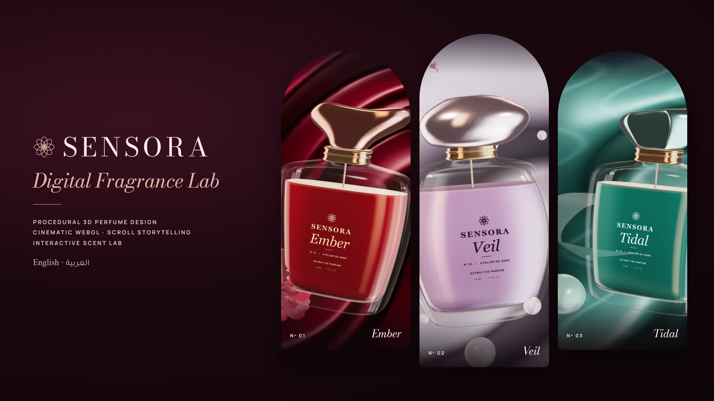

  <a href="https://sensora-cyan.vercel.app/en"><b>Live experience</b></a> &nbsp;·&nbsp;
  <a href="https://sensora-cyan.vercel.app/ar"><b>Arabic</b></a> &nbsp;·&nbsp;
  <a href="../README.md"><b>Repository</b></a> &nbsp;·&nbsp;
  <a href="media/preview.mp4"><b>Motion preview</b></a>

**Role:** creative direction, 3D, shaders, motion and front-end engineering
**Stack:** Next.js 16 · React 19 · TypeScript · Three.js r182 · React Three Fiber · GSAP + ScrollTrigger · Lenis
**Type:** independent portfolio concept. The fragrances are fictional.

---

## 1. Project overview

SENSORA is a single-page fragrance film. A visitor scrolls through seven chapters (First Breath, The Invisible, Ember, Veil, Tidal, the Scent Lab and the Ritual) while one perfume bottle lives in one continuous real-time studio. The bottle changes shape, liquid, stopper and print as it passes from world to world. In the Lab, the visitor composes their own version, and that composition is the bottle presented in the closing Ritual.

Everything visible in 3D is authored in TypeScript: geometry, materials, lighting environment, silk and sculptures. No `.glb`, HDRI or texture files are involved. The page ships in English and Arabic, and each language has its own composition.

## 2. Creative vision

Perfume is sold through film: slow light across glass, fabric moving where no wind is visible, a product that seems to breathe. The brief was to bring that grammar to the browser **without turning it into a video**. The bottle must be a real object that responds to the visitor, the scroll must be the camera, and the visitor's choices must change what they see.

The guiding line, *Wear what you feel*, set the tone. Each scent is a mood first and a product second.

## 3. Design challenge

Three tensions shaped the project:

1. **Cinema vs. control.** Film is linear. A website is scrubbed forwards, backwards, by keyboard, by anchor link and by language switch. Every shot had to look authored and still be fully reversible.
2. **Product photography vs. integrated GPUs.** Luxury glass needs refraction, reflections and depth. A large share of laptops run on integrated graphics, which cannot afford a full transmission pass at high resolution.
3. **Editorial typography vs. a moving product.** Large serif display type and a 3D bottle compete for the same space on every screen size, in two reading directions.

## 4. Art direction

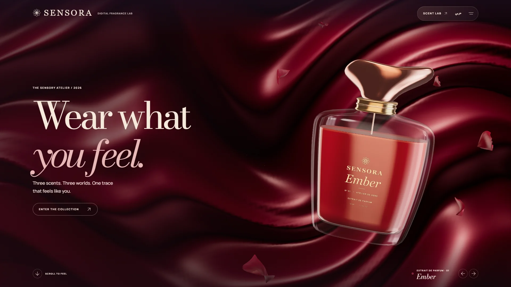

The direction is a dark studio with one hero light, deep jewel tones and generous negative space. The typography is a high-contrast Didone (Bodoni Moda) set tight for display, paired with a quiet grotesque (Manrope) for interface and micro-labels. Colour is almost entirely carried by the 3D scene. The DOM stays in a narrow range of warm paper and blush, so the product always owns the saturation.

Composition follows an editorial rule: copy holds one column, the product holds a reserved rectangle beside it, and the two never overlap. In Arabic the composition is genuinely re-staged. The product, the studio light and the fold direction of the silk all move to the other side.

## 5. Brand identity

The SENSORA mark is an eight-petal rosette drawn from ellipses, the same construction used for the bottle's printed emblem and the engraved plate in the chapter index. The wordmark is widely tracked Bodoni capitals. The edition numbering (*Nº 01–03*), the *Extrait de parfum* line and the label hierarchy treat the bottle as a believable product. The footer and metadata are explicit that SENSORA is a portfolio concept.

## 6. Fragrance world design

<table>
<tr>
<td width="33%">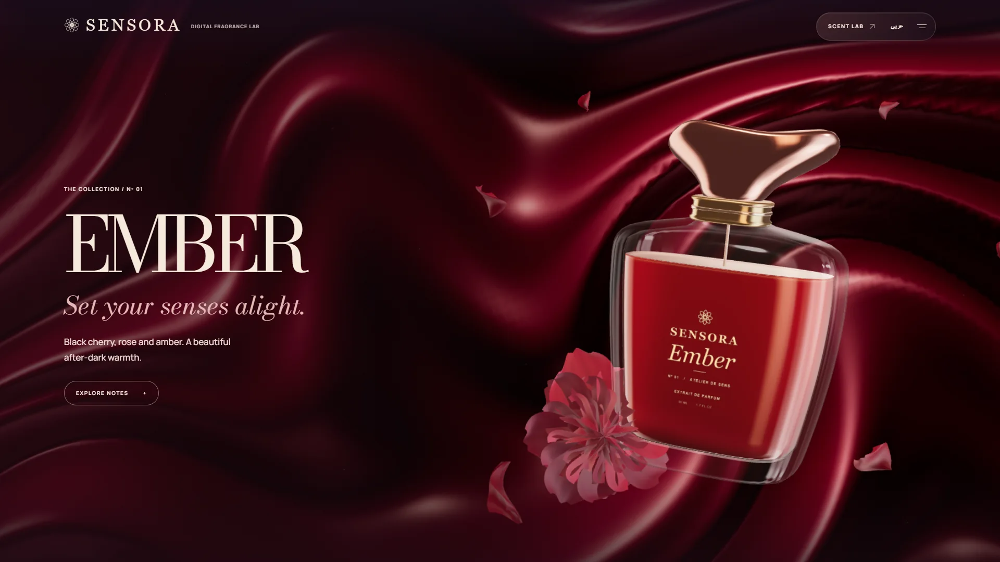 <b>Ember</b>: garnet satin, petals, a sculpted bloom</td>
<td width="33%">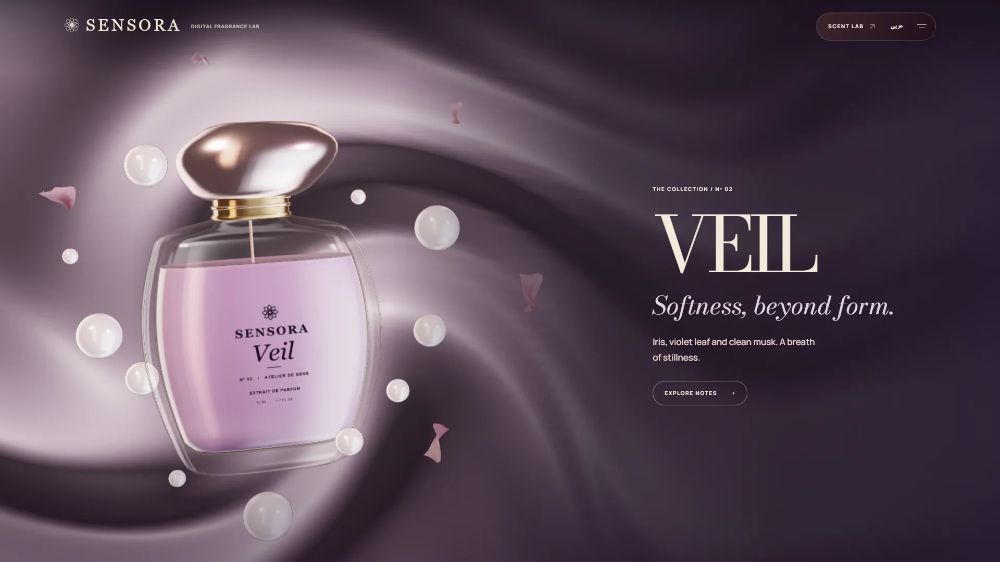 <b>Veil</b>: pearl gauze and an orbit of pearls</td>
<td width="33%">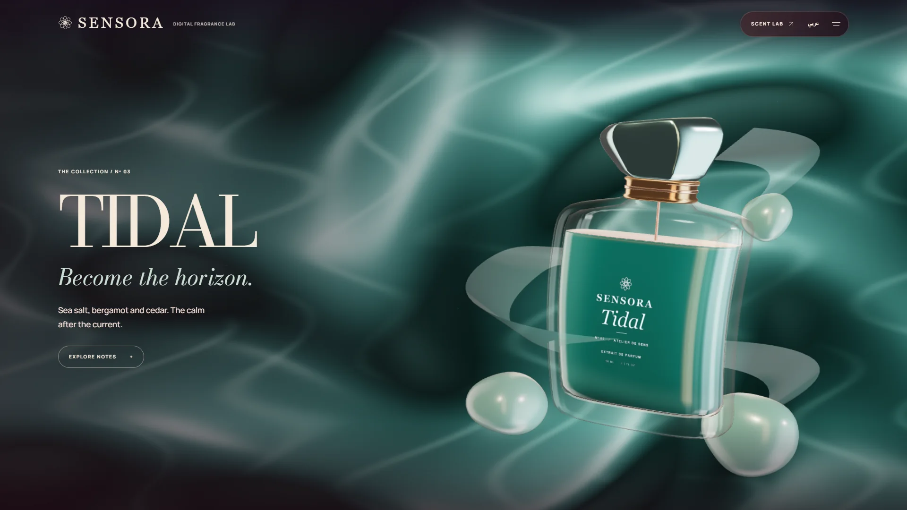 <b>Tidal</b>: caustic satin, water ribbon, sea-glass minerals</td>
</tr>
</table>

Each world is a parameter set, not a separate scene: a sky colour, a silk colour and fold regime, a light tint, a sculpture group and an edition of the bottle. Moving between chapters interpolates all of them at once, so worlds *dissolve* into one another instead of cutting.

- **Ember**: warm, sensual, after dark. Deep crimson silk with rolling pleats, drifting rose petals (one instanced draw) and a 29-petal bloom at the bottle's heel.
- **Veil**: still and powdery. The silk switches to a softer gauze regime, the light turns pearl, and twelve iridescent pearls orbit the bottle.
- **Tidal**: open and mineral. A long swell replaces the pleats, caustic light runs across the satin and through the atmosphere, and a translucent ribbon of water wraps the bottle above polished sea-glass stones.

## 7. Procedural 3D bottle architecture

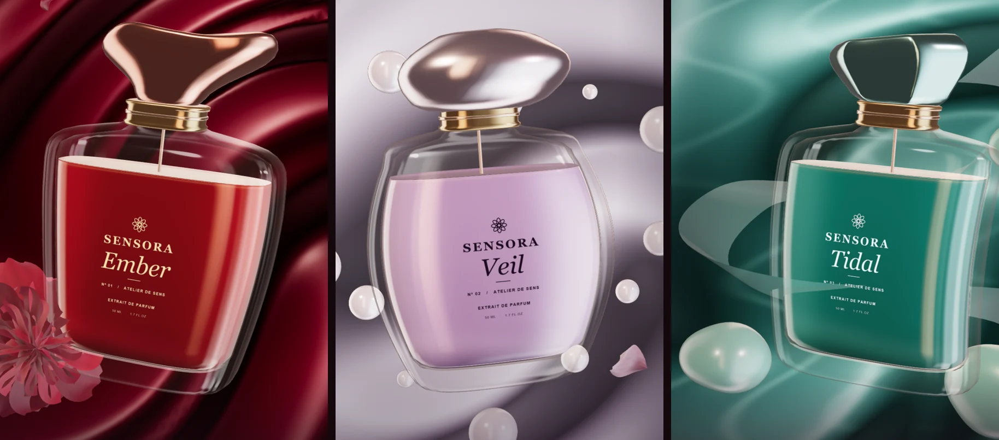

The bottle is built from **profiles**: lists of `[height, width, depth]` rings. A loft function sweeps a **superellipse** cross-section (exponent 0.63, so square-shouldered but soft) through each profile at 192 segments around. The glass is one continuous surface. It runs up the outside, over the lip and back down the inside cavity, which makes the heavy optical heel and the shoulder thickness physically visible. Side fluting is a cosine modulation that fades out toward the front faces and dissolves into the shoulder.

The liquid is a second, inset loft with its own meniscus ring. The stopper, collar and two machined bands are further lofts. The label is a curved plane that follows the front of the superellipse and carries a canvas-drawn print, with letterspacing set per glyph.

**Editions as morph targets.** Ember, Veil and Tidal are not three models. A shaping function rewrites the same vertices for each edition, giving Ember a tapered body and flared crest, Veil a barrel body and pebble stopper, and Tidal a straight mineral body and slanted faceted cut. The results are stored as two morph targets (position and normal) on the glass, liquid, stopper and label. Changing fragrance blends all four parts in one motion. Once an edition settles, the renderer swaps to pre-built **fixed** buffers for that edition, so the shader does no morph work in a still frame.

The full product is about **23 k vertices and 46 k triangles**.

**A lesson from the audit.** The edition shapes bend the body width along its height, but the original profiles had only five rings across the body, and the liquid had a single segment. The curves therefore resolved into visible facets, and the liquid stayed straight inside a rounded glass. Resampling every profile to a maximum ring spacing before morphing fixed it at the source, without raising any other resolution.

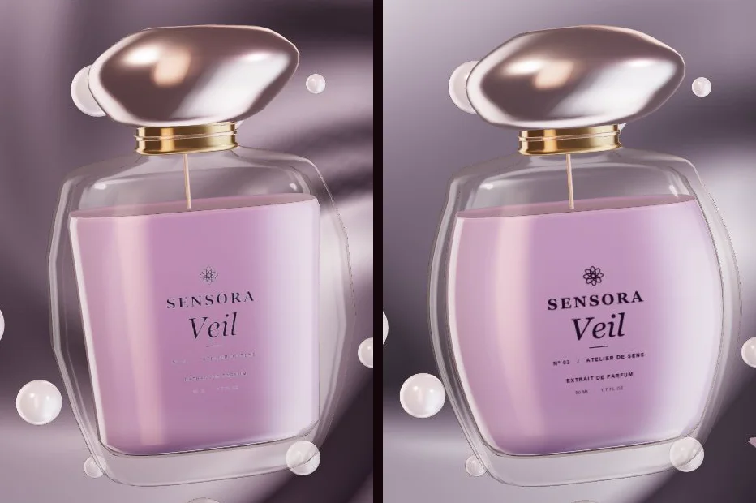 Veil before (left) and after (right) profile resampling and the label ink change.

## 8. Glass and liquid rendering

Physically based glass in WebGL has a cost problem. `MeshPhysicalMaterial` transmission renders the scene a second time into a buffer behind the object. SENSORA uses two paths with the same geometry:

- **Full transmission** on capable GPUs: IOR 1.51, 0.52 thickness and attenuation tinted live to the liquid colour. A generated studio environment provides the reflections.
- **Reflective shell** on integrated graphics: the transmission pass is dropped. A small `onBeforeCompile` patch makes the shell's opacity follow Fresnel incidence and the brightness of the reflected light cards, so edges and highlights read as glass while the separate liquid volume shows through the face.

The liquid has its own shader patch, which models **optical depth**. Absorption is derived from the liquid colour and applied along an approximate path length that is longer through the centre and at the heel. A pool of light settles at the base, and a bright meniscus line sits under the surface. This is what makes the colour feel deep rather than painted.

The **studio environment** is generated at startup. It is a 384 × 192 floating-point equirectangular map with soft-edged light cards and thin kicker strips, filtered through PMREM. Nothing is downloaded, and the reflections are tuned specifically for the bottle's flat faces.

## 9. Cinematic silk and atmospheric shaders

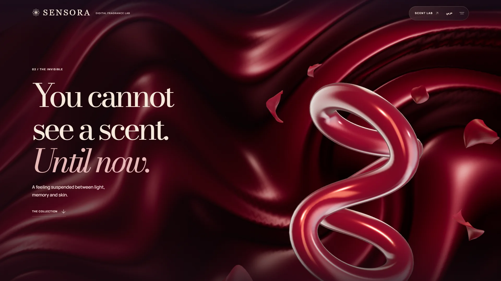

The silk is a large plane displaced in the vertex shader by a height function with three regimes: rolling **pleats** for Ember, **gauze** for Veil and **swell** for Tidal. Intermediate states blend between them. The fold field twists around a *gather point* that is updated every frame to the bottle's position in the cloth's local space, so the fabric always appears to pool around the product.

Normals come from finite differences of the same height function. They are interpolated as slopes and normalized per pixel, which keeps the narrow satin highlights from breaking into facets. The fragment shader combines a diffuse term, a tight sheen lobe, a grazing ridge light, a slow travelling "beam" and a fine thread highlight. Tidal adds caustics. Output is dithered after tone mapping to avoid banding in the deep tones.

Behind the silk, a full-screen **atmosphere** pass paints a soft halo whose origin follows the product's side of the composition. It adds breathing air bands and, for Tidal, caustic light. Sparse instanced **pollen** points drift in front for depth.

## 10. Motion design and GSAP

Motion has three layers, each with its own owner:

1. **The film** (camera, product pose, scene weights) is driven by scroll through a paused master timeline.
2. **Typography reveals** are scrubbed ScrollTriggers per chapter: masked word or letter rises, a cascading stagger per world (Ember rises with a tilt, Veil drops softly, Tidal slides in from the side), and eyebrow rules that draw in.
3. **Ambience** (silk drift, petal flight, pearl orbit, the bottle's slow breathing) runs on the frame clock and stops completely under reduced motion.

Text animation respects language. English display words can split into letters. Arabic always animates whole words, because splitting would break contextual letter joining. A subtler finding came from the audit: letter-splitting also destroys **kerning**, and the bundled Bodoni subset has no `W`+vowel kerning pair at all. The hero now reveals by word and applies the same optical correction the font uses for `V`.

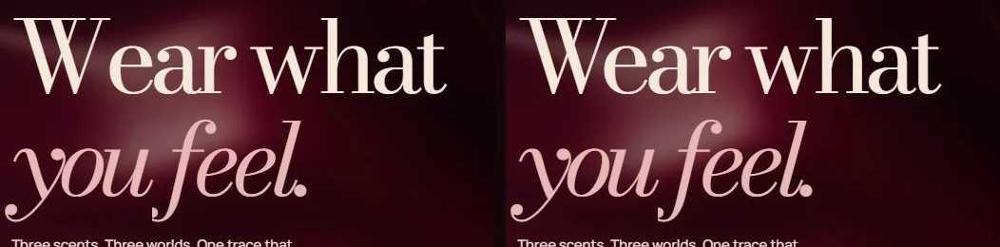 "Wear what" before (left) and after (right).

## 11. Scroll-driven storytelling

Each chapter transition is described as a **shot**: hold, travel duration, a mid-transition *passage* (the camera leans in and orbits) and a roll, each with its own easing. The shots are laid onto one paused GSAP timeline. On every scroll update, the current section and its local progress are converted to a timeline time and the timeline is *sampled*, never played. Scrolling backwards therefore retraces the identical path. Fast flings, anchor jumps and the chapter index all land in the same pose as a slow scroll.

Product placement is solved from layout, not hard-coded. Each section contains an invisible **product rectangle** in its CSS grid. These are measured on resize and font load (never in the frame loop) and converted into scene units. The bottle is fitted to the visible part of that rectangle beneath the header, and the scale collapses smoothly to zero at the midpoint when the product changes sides. Copy and product never collide at any viewport.

Lenis provides smoothing, wired into GSAP's ticker. Opening the chapter index stops it, and the reduced-motion preference removes it entirely.

## 12. Interactive Scent Lab

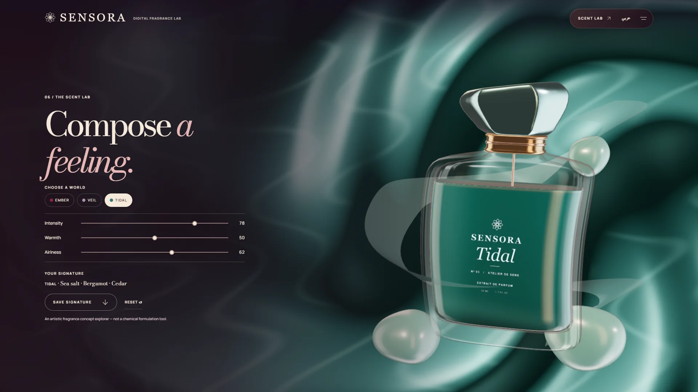

The Lab is deliberately small, and every control visibly changes the render:

- **World**: morphs the bottle, swaps the print, recolours liquid and silk, and brings in that world's sculpture.
- **Intensity**: deepens or lightens the liquid's optical density.
- **Warmth**: shifts liquid hue and the lightness of the textile light.
- **Airiness**: spreads and scales the petal field.

A live summary reads the composition back as text with a polite live region. *Save signature* downloads a localized text card. The Ritual then presents exactly this edition, on a stone plinth tinted to match. The formula is kept in session storage, so a visitor who switches language in the Ritual arrives in Arabic with the same bottle and the same values.

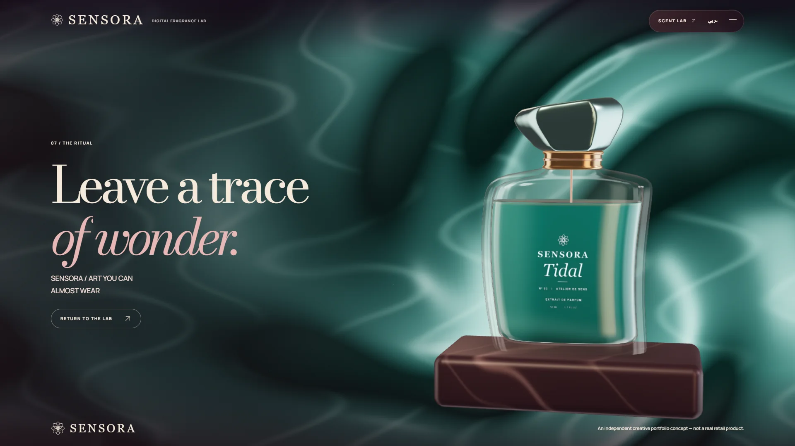

## 13. Bilingual UX and RTL

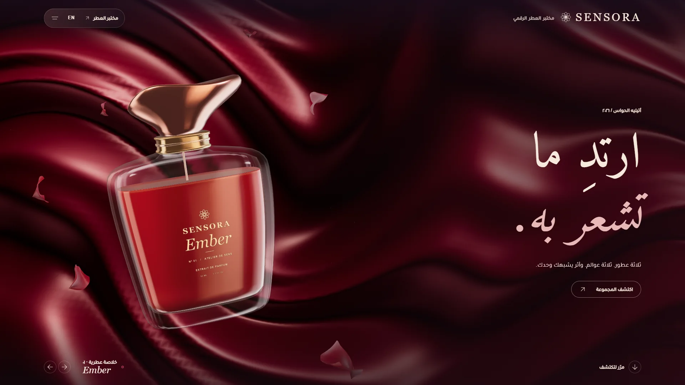

Arabic is a first-class edition, not a translation layer:

- **Typography**: Amiri for display (a classical Naskh with real calligraphic weight) and Tajawal for text. Tracking is reset to zero and line heights are raised for Arabic.
- **Layout**: CSS logical properties throughout. The product rectangle, the studio light, the silk direction, the atmosphere origin and the menu's mask origin all mirror with `dir`.
- **Numerals**: Lab readouts use Arabic-Indic digits through `toLocaleString("ar-EG")`. Edition names stay in Latin capitals, isolated with `dir="ltr"`, as a luxury house would print them.
- **Continuity**: the language control keeps the current chapter and, since the audit, the visitor's composition.

## 14. Responsive experience

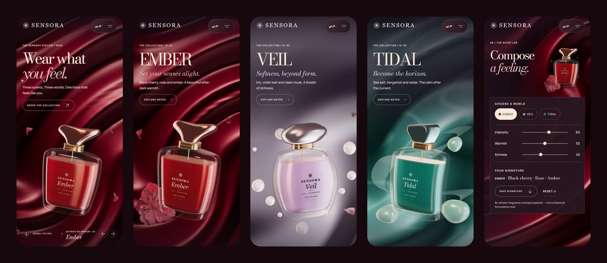

Phones get their own compositions. Copy moves to the top, the product rectangle takes the lower half, the silk gets a portrait framing and its own light angle, and the Lab console becomes a translucent panel beneath a small hero bottle. Short desktop viewports have their own type scale.

The responsive suite checks 10 viewports (1920 × 1080 down to 360 × 800, plus a short 1280 × 640) × 7 chapters × 2 languages, which is 140 settled states, for horizontal overflow, clipped copy and copy under the header.

## 15. Performance engineering

The goal was premium rendering on strong hardware and a smooth film on a common integrated GPU, without a visible downgrade in the middle of a scroll.

- **Capability tiers.** The renderer string chooses the glass path at startup (full transmission vs. reflective shell).
- **Adaptive density.** Discrete GPUs render at up to 1.5×. Integrated GPUs try 1.25×, so 125 % laptop displays are not upscaled from a 1× buffer, and settle **once** on the CSS pixel grid if they cannot hold 45 fps. The audit measured why the step is needed. At 1.25× on the UHD 630 the hero ran at 35.4 fps, just above the older 35 fps trigger, so it never stepped down. With the new tier it settles within about 2.5 s and holds 45–58 fps.
- **Cheap frames.** Typical frames issue 11–15 draw calls: instanced petals and pearls, fixed buffers for settled editions, and no DOM reads in the frame loop. React does not re-render per frame. All live values flow through a mutable director object.
- **Lifecycle.** Hidden tabs stop rendering. Reduced motion switches to on-demand frames. WebGL context loss falls back to the still edition.

| Intel UHD Graphics 630 | Hero | Ember | Veil | Tidal | Lab | Ritual |
|---|---:|---:|---:|---:|---:|---:|
| 1440 × 900 @1× | 56.6 | 53.3 | 53.7 | 53.3 | 51.0 | 59.3 |
| 1536 × 864 @1.25× | 58.3 | 51.9 | 53.3 | 52.0 | 44.8 | 47.5 |
| 390 × 844 @3× (emulated) | 59.7 | 60.1 | 60.2 | 59.6 | 60.2 | 60.2 |

Rendered frames per second, headless Chromium with ANGLE/D3D11, production build, 4.5 s per chapter. Phone figures use the same desktop GPU with emulated viewport and pixel ratio.

## 16. Technical challenges

- **Reversible film.** Playing timelines on scroll direction drifts. Sampling one paused timeline from scroll position removed the whole class of "stuck" or "reset" states.
- **Morphing without popping.** Normals are morphed alongside positions so lighting changes with shape. Fixed buffers replace morphing once settled.
- **Layout-aware 3D.** Measuring DOM rectangles and converting them to scene units let CSS stay the single source of composition across both languages and every breakpoint.
- **Glass on integrated GPUs.** The reflective shell keeps the bottle legible as glass at a fraction of the cost of a second scene pass.
- **Silk highlights.** Narrow satin highlights exposed mesh sampling. A camera-fitted grid, slope interpolation and per-pixel normals made them continuous at native resolution.

## 17. Quality assurance

QA was done in a real browser against the production build, not inferred from code:

- **Functional:** 28 automated checks. They cover every world in both languages, the hero switcher (pointer and keyboard), five consecutive Lab selections, keyboard sliders, Lab → Ritual hand-off, language-switch persistence, signature download, the chapter index (Escape, focus return, chapter landing), the notes explorer, wheel-driven scroll reversal through Lenis, 140 responsive states, reduced motion and the no-WebGL edition.
- **Visual:** full-size review of every chapter in both languages at desktop and phone sizes, before and after each fix.
- **Performance:** isolated GPU frame sampling per chapter on the target integrated GPU.

The final audit, with severity-ranked findings, root causes and before/after evidence, is in [`qa/final-audit/AUDIT_REPORT.md`](../qa/final-audit/AUDIT_REPORT.md). It also records what was **not** verified: Firefox, Safari, physical phones and screen-reader output.

## 18. Final outcome

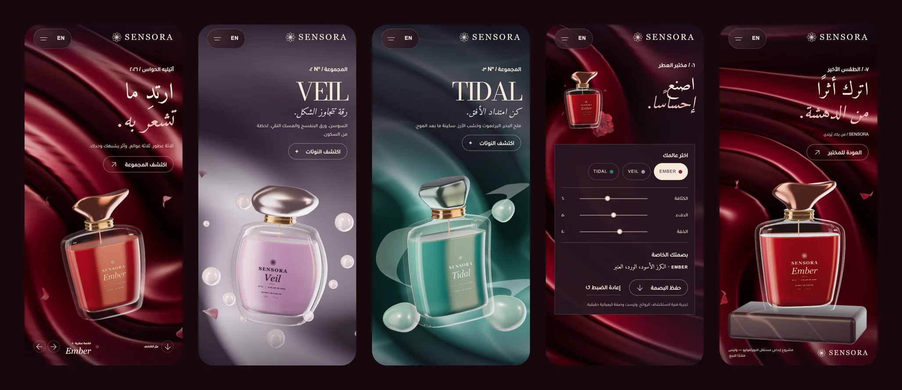

SENSORA delivers a continuous, reversible fragrance film with three procedurally modeled bottles that morph between editions. It has shader-driven silk and atmosphere, a Lab whose every control changes the render, and a closing scene that presents the visitor's own composition. It is fully composed in English and Arabic, framed for phones as well as wide screens, and smooth on a common integrated GPU.

## 19. Lessons learned

- **Audit the font, not just the layout.** A missing kerning pair in a bundled subset was the most visible flaw on the page, and only measurement revealed it.
- **Fix resolution at the source.** Faceted silhouettes came from sparse profiles, not from too few pixels or too low a DPR. Targeted resampling beat any global quality increase.
- **Thresholds need data.** An adaptive system with a well-meant 35 fps trigger sat exactly above the measured 35.4 fps and never acted. Every tier now comes from a measurement.
- **State belongs to the visitor.** A language switch is a page load. Anything the visitor composed has to survive it.

## 20. Future possibilities

- Warm shader programs asynchronously behind the prologue to shorten time-to-first-scene on integrated graphics (currently 3–8 s on the UHD 630).
- A shareable signature: encode the Lab formula in the URL so a composition can be sent and reopened.
- Sound design that follows the worlds, with an explicit opt-in.
- A measured pass on physical iOS and Android devices and in Safari and Firefox.

---

SENSORA is an independent creative portfolio concept and not a real retail product. All design, code, 3D geometry and shaders are original. Typefaces are used under the SIL Open Font License 1.1.
